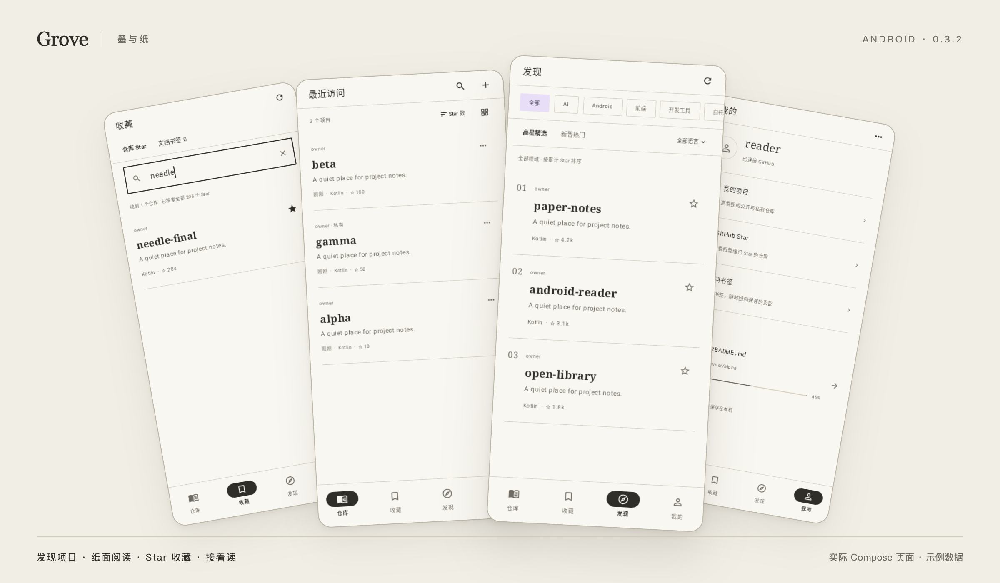

# Grove · 墨与纸

一个偏爱阅读的 GitHub 客户端。用暖白纸面、紧凑排版和清晰导航，浏览项目、阅读文档、收藏值得再看的内容。

**目前仅支持 Android 8.0+ · Kotlin + Jetpack Compose · 正式版 0.5.2**

<p align="center">
  
</p>

<sub>实际 Compose 页面，使用示例数据在 Robolectric 原生图形模式下渲染。图片预览已在 Android 14 真机验证，完整验证范围见开发指南。</sub>

## 可以做什么

| 场景 | 功能 |
| --- | --- |
| 阅读项目 | 默认阅读 README；阅读目录、字号、纸色与专注阅读；底部文件面板快捷切换文档，按需展开文件搜索；右上角更多切换分支或查看 Issues |
| 阅读 Markdown | 表格优先适宽、长内容换行，宽表格横向滚动；封面书架自动排列；任务列表、代码高亮、Mermaid、KaTeX 公式与相对图片链接；普通文档与源码支持快捷回到顶部 |
| 查看附件 | 图片缩放与长按保存、SVG 预览 / 源码切换、PDF 分页与细步缩放、Excel / CSV 多工作表 |
| 阅读电子书 | EPUB 2 / 3 目录、切章、字号与纸色；本章滚动进度和全书估算进度；PDF 左右滑动翻页、EPUB 左右滑动切章 |
| 文件与缓存 | PDF / EPUB 下载进度、后台及熄屏下载、失败后重试续传；「我的 → 设置 → 缓存管理」查看大小、一键清理 |
| 管理收藏 | GitHub Star 添加与移除；点击右上角搜索全部 Star、本机文档书签；下拉刷新、上拉加载 |
| 浏览发现 | 按领域和语言筛选高星项目、近 30 天新项目；支持 GitHub 项目搜索，返回时保留滚动位置 |
| 接着阅读 | 最近访问可置顶、排序和移除；按账号记住列表 / 卡片模式、书签与阅读位置 |
| 查看讨论 | 只读 Issues、Open / Closed 筛选、详情与评论滚动加载 |

「足迹」页展示访问记录；登录后的全部账号项目位于「我的 → 我的项目」。底部导航在切换后保留各自打开的项目页面与阅读位置，页面内返回逐层回到入口；再次点击已选中的「足迹」可直接回到访问记录首页。访客可以阅读公开仓库，自己的 GitHub 账号授权后可访问获准的私有仓库。

## 下载

- [下载 Android APK · v0.5.2](https://github.com/yunxiange/grove/releases/download/v0.5.2/Grove-0.5.2.apk)
- [版本说明与附件](https://github.com/yunxiange/grove/releases/tag/v0.5.2) · [SHA-256 校验文件](https://github.com/yunxiange/grove/releases/download/v0.5.2/Grove-0.5.2-SHA256.txt)

提供不可调试的 Release APK，支持 Android 8.0+。为兼容已有安装，沿用此前版本的开发签名证书，可直接覆盖升级并保留本机记录；这与应用商店专用发布签名不同。此版本在 GitHub 正式发布，尚未上架应用商店。

## 本地构建

需要 **JDK 17+、Android SDK 35、Build Tools 35.0.0**。用 Android Studio 打开项目，或设置好 `JAVA_HOME` 与 Android SDK 后执行：

```sh
./gradlew :app:assembleDebug :app:testDebugUnitTest :app:lintDebug
```

APK 输出：`app/build/outputs/apk/debug/app-debug.apk`。阅读器资源已打包进工程，普通 Android 构建无需 Node.js。

修改 `reader/src/` 时，需要 Node.js 22.12+，在 `reader/` 内执行 `npm ci && npm test && npm run build`。

- [开发指南：构建、GitHub 授权、文件预览与测试](docs/development.md)
- [界面图来源与叠放布局](docs/screenshots/README.md)

## 当前状态

普通用户无需创建 GitHub App 或填写 Client ID。GitHub App 已配置 Starring 读写权限，仓库内容、Issues 与元数据保持只读；已有用户若遇到 Star 权限提示，请重新登录并接受权限更新。私有仓库仅在用户与应用均获准访问时可读，组织仓库可能需要管理员批准。

图片空白修复已在 OnePlus 8T（Android 14、WebView 156）真机确认；PDF、Excel 和登录 / Star / 私有仓库的完整端到端流程仍需更多设备验证。预览诊断默认关闭，需要时在「我的 → 设置 → 关于 Grove → 开发者选项」开启。

项目内容和 Issues 为只读，Star 支持写入。本机书签和阅读记录暂不支持跨设备同步。GitHub 登录凭据由 Android Keystore 加密保存；工程中的 Client ID 和应用 slug 是公开标识，APK 不包含应用私钥或 Client Secret。

匿名访问受 GitHub API 额度限制。EPUB 不支持 DRM；全书进度为估算值。后台下载不保证系统强制结束进程后的自动续跑；重新打开同一版本文件可重试续传。预览大小、表格行列与分支数量等边界见[开发指南](docs/development.md#文件预览)。
